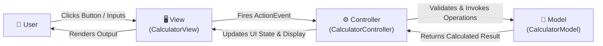

# Experiment 02: Model-View-Controller (MVC) Pattern Calculator

## 🎯 Aim & Objective
To design and implement a desktop Calculator application strictly adhering to the **Model-View-Controller (MVC)** architectural design pattern, demonstrating loose coupling, modularity, and clean separation between business logic, presentation, and event handling.

---

## 🛠️ Technology Stack
- **Language:** Java (JDK 17 or higher)
- **Architecture:** Model-View-Controller (MVC) Pattern
- **GUI Framework:** Java Swing (`javax.swing.*`, `java.awt.*`)
- **Concurreny/Threading:** Swing Event Dispatch Thread (`SwingUtilities.invokeLater`)

---

## 📂 Directory Structure
```
02-MVC-Calculator/
├── CalculatorModel.java        # MODEL: Arithmetic business logic & mathematical rules
├── CalculatorView.java         # VIEW: Swing GUI components, input layout & display
├── CalculatorController.java   # CONTROLLER: Action event handling, input validation & dispatch
├── Main.java                   # Application bootstrap & entry point
└── README.md                   # Detailed documentation and execution guide
```

---

## 💡 Architecture & Design Pattern



### 1. Model (`CalculatorModel.java`)
- Independent of any GUI or UI libraries.
- Implements arithmetic operations: `add`, `subtract`, `multiply`, and `divide`.
- Safeguards against mathematical anomalies (throws `ArithmeticException` on division by zero).

### 2. View (`CalculatorView.java`)
- Extends `JFrame` to provide inputs (`First Number`, `Second Number`), operator buttons (`+`, `-`, `×`, `÷`), a read-only result field, and a reset button.
- Contains no computational logic; purely responsible for visual layout and exposing accessor/mutator methods.

### 3. Controller (`CalculatorController.java`)
- Implements `ActionListener` to capture button events.
- Performs input validation (checks for empty strings, handles non-numeric formatting via `NumberFormatException`).
- Calls the corresponding Model method and pushes the formatted result back to the View.

---

## 🚀 How to Compile & Run

### Windows (PowerShell / Command Prompt)
```powershell
# Navigate into the experiment folder
cd 02-MVC-Calculator

# Compile all source files
javac *.java

# Run the application
java Main
```

### Linux / macOS (Terminal)
```bash
cd 02-MVC-Calculator
javac *.java
java Main
```

---

## 📋 Sample Run & Verification
1. **Launch:** Run `java Main`. The Calculator window displays with input fields and operator buttons.
2. **Addition Test:** Enter `15.5` in First Number, `4.5` in Second Number, click `+`. Result displays `20`.
3. **Subtraction Test:** Enter `50` and `18`, click `-`. Result displays `32`.
4. **Multiplication Test:** Enter `12.5` and `4`, click `×`. Result displays `50`.
5. **Division Test:** Enter `100` and `8`, click `÷`. Result displays `12.5`.
6. **Zero Division Guard:** Enter `25` and `0`, click `÷`. A dialog alerts: `"Division by zero is undefined."`
7. **Clear / Reset:** Click `Clear / Reset` to wipe all input fields and refocus the cursor.

---

## 📚 Viva Questions & Conceptual Insights
1. **What are the primary benefits of the MVC pattern?**  
   MVC decouples data representation from user interaction. This allows changing the UI (View) or switching calculation engines (Model) without breaking the rest of the application, dramatically simplifying unit testing.
2. **Why does `CalculatorModel` not import any `javax.swing` packages?**  
   The Model should represent pure domain business logic. Keeping it free of UI dependencies makes it reusable across CLI, web, desktop, or mobile frontends.
3. **Why do we launch the GUI using `SwingUtilities.invokeLater()`?**  
   Swing components are not thread-safe. `invokeLater` schedules UI initialization onto the dedicated Event Dispatch Thread (EDT) to prevent concurrency races.

---

## 👤 Author
- **Developer:** Pankaj Sharma
- **Repository:** [Java-programs](https://github.com/Pankaj7437/Java-programs)
