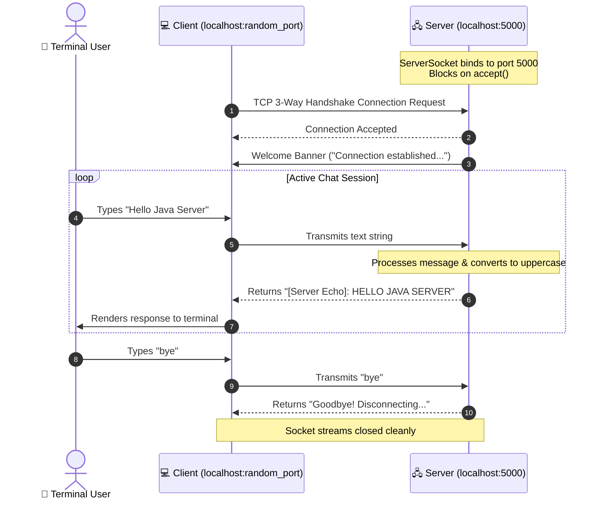

# Experiment 03: TCP Socket Client-Server Network Communication

## 🎯 Aim & Objective
To implement reliable, connection-oriented network communication over a TCP/IP network using the Java Sockets API (`java.net.ServerSocket` and `java.net.Socket`), demonstrating continuous bi-directional streaming, message echoing, and graceful session termination.

---

## 🛠️ Technology Stack
- **Language:** Java (JDK 17 or higher)
- **Networking APIs:** `java.net.ServerSocket`, `java.net.Socket`
- **I/O Streaming:** `java.io.BufferedReader`, `java.io.InputStreamReader`, `java.io.PrintWriter`
- **Transport Protocol:** TCP (Transmission Control Protocol) on Port `5000`

---

## 📂 Directory Structure
```
03-ClientServer-Sockets/
├── Server.java     # Multithread-ready TCP Socket Server daemon on port 5000
├── Client.java     # Interactive TCP Client transmitting user input to Server
└── README.md       # Comprehensive documentation and execution guide
```

---

## 💡 Architecture & Communication Flow



### 1. `Server.java` Workflow
1. Binds to TCP port `5000` using `ServerSocket(5000)`.
2. Blocks on `serverSocket.accept()` waiting for incoming client connections.
3. Upon connection, wraps the socket's `InputStream` and `OutputStream` into a buffered reader and autoflush writer.
4. Reads incoming messages in a loop, prints them with timestamps, and transmits back an uppercase echo string.
5. If the client sends `"bye"`, the server breaks the session loop, closes the client socket, and remains alive ready for the next incoming client.

### 2. `Client.java` Workflow
1. Initiates a connection to `localhost:5000` via `new Socket("localhost", 5000)`.
2. Reads the server's initial handshake message.
3. Provides an interactive terminal prompt (`> `) to accept user input.
4. Transmits lines to the server and blocks until the server's echo reply is received and printed.
5. Exits cleanly upon sending `"bye"`.

---

## 🚀 How to Compile & Run

Running socket programming requires **two separate terminal windows** (one for Server, one for Client).

### Step 1: Open Terminal 1 (Start Server)
```powershell
cd 03-ClientServer-Sockets

# Compile both files
javac *.java

# Start the TCP Server
java Server
```
*Expected Server Output:*
```
==================================================
        TCP SOCKET ECHO SERVER INITIALIZING       
==================================================
[INFO] Server starting on port 5000...
[INFO] Server listening. Waiting for client to connect...
```

### Step 2: Open Terminal 2 (Start Client)
```powershell
cd 03-ClientServer-Sockets

# Start the TCP Client
java Client
```
*Expected Client Output:*
```
==================================================
           TCP SOCKET CLIENT STARTING             
==================================================
[INFO] Attempting connection to localhost:5000...
[SUCCESS] Connected to server successfully!
[SERVER] Connection established to TCP Server. Type messages or 'bye' to quit.
--------------------------------------------------
Enter text to transmit (Type 'bye' to exit):
> Hello Server!
[Server Echo]: HELLO SERVER!
> Advanced Java Programming
[Server Echo]: ADVANCED JAVA PROGRAMMING
> bye
Goodbye! Disconnecting from server...

[INFO] Session terminated. Closing client connection.
```

---

## 📚 Viva Questions & Conceptual Insights
1. **What is the difference between TCP and UDP sockets?**  
   TCP (`Socket`/`ServerSocket`) is connection-oriented, reliable, guarantees packet ordering, and uses flow control. UDP (`DatagramSocket`) is connectionless and faster, but does not guarantee packet delivery or order.
2. **What does `serverSocket.accept()` do?**  
   It is a blocking call that halts execution until an incoming client connection request arrives. Once connected, it returns a new `Socket` object bound to that specific client connection.
3. **Why do we pass `true` to `new PrintWriter(out, true)`?**  
   The second parameter enables auto-flushing, ensuring data is immediately transmitted across the network stream whenever `println()` or `printf()` is invoked, without waiting for the buffer to fill.

---

## 👤 Author
- **Developer:** Pankaj Sharma
- **Repository:** [Java-programs](https://github.com/Pankaj7437/Java-programs)
