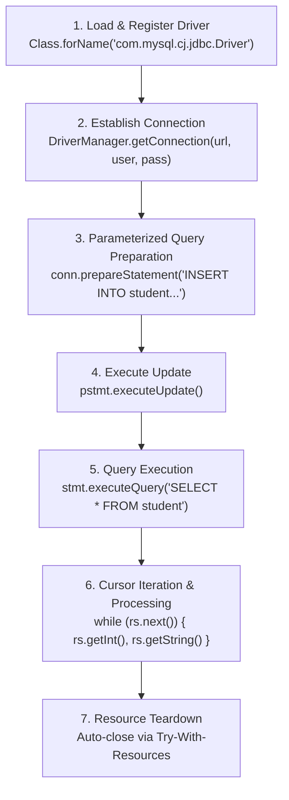

# Experiment 04: Java Database Connectivity (JDBC) CRUD Operations

## 🎯 Aim & Objective
To establish a database connection between a standalone Java application and a MySQL relational database management system using the JDBC Type-4 (Native Protocol) driver, execute parameterized SQL `INSERT` statements using `PreparedStatement`, query records using `Statement`, and process tabular rows via `ResultSet`.

---

## 🛠️ Technology Stack
- **Language:** Java (JDK 17 or higher)
- **Database Engine:** MySQL Server 8.0+
- **JDBC Driver:** MySQL Connector/J (`mysql-connector-j-26.7.0.jar`)
- **Core APIs:** `java.sql.Connection`, `DriverManager`, `PreparedStatement`, `Statement`, `ResultSet`

---

## 📂 Directory Structure
```
04-JDBC-Database-Operations/
├── lib/
│   └── mysql-connector-j-26.7.0.jar  # Official MySQL JDBC Driver library
├── src/
│   └── Main.java                     # Main class implementing complete JDBC lifecycle
├── schema.sql                        # Database schema definition and seed data
└── README.md                         # Detailed documentation and run guide
```

---

## 💡 Architecture & JDBC Lifecycle



### Key Highlights
- **Parameterized SQL Security:** Uses `PreparedStatement` with placeholder binding (`?`) to prevent SQL Injection attacks.
- **Resource Management:** Employs Java 7+ `try-with-resources` ensuring all `Connection`, `Statement`, and `ResultSet` handles are automatically closed even if an exception occurs.
- **Configurable Credentials:** Supports environment overrides (`DB_URL`, `DB_USER`, `DB_PASSWORD`) with sensible defaults (`root` / `password`).

---

## 🗄️ Database Setup

Before executing the Java application, create the database and table in MySQL:

```bash
# Connect to MySQL and execute the setup script
mysql -u root -p < schema.sql
```

Alternatively, open your MySQL shell and execute:
```sql
CREATE DATABASE IF NOT EXISTS college_db;
USE college_db;

CREATE TABLE IF NOT EXISTS student (
    id INT PRIMARY KEY,
    name VARCHAR(100) NOT NULL,
    branch VARCHAR(50) NOT NULL
);
```

---

## 🚀 How to Compile & Run

### Windows (PowerShell / Command Prompt)
```powershell
cd 04-JDBC-Database-Operations

# Compile the source code with JDBC driver in classpath
javac -cp "lib/*" -d bin src/Main.java

# Run the compiled program
java -cp "bin;lib/*" Main
```

### Linux / macOS (Terminal)
```bash
cd 04-JDBC-Database-Operations

# Compile
javac -cp "lib/*" -d bin src/Main.java

# Run (notice colon separator on Unix)
java -cp "bin:lib/*" Main
```

---

## 📋 Sample Run Output
```
==============================================================
         JAVA DATABASE CONNECTIVITY (JDBC) CRUD SYSTEM        
==============================================================
[INFO] Target Database: jdbc:mysql://localhost:3306/college_db
[INFO] Database User:   root
[SUCCESS] MySQL JDBC Driver registered successfully.
[SUCCESS] Database connection established successfully!

[INSERT] PreparedStatement executed successfully (1 row(s) updated).

--------------------------------------------------------------
                   STUDENT RECORDS TABLE                      
--------------------------------------------------------------
ID       | STUDENT NAME                 | BRANCH / DEPARTMENT           
--------------------------------------------------------------
101      | Pankaj Sharma                | Computer Science & Engineering
102      | Priyanka Verma               | Information Technology        
103      | Aarav Patel                  | Electronics & Communication   
--------------------------------------------------------------
[INFO] Total student records retrieved: 3
```

---

## 📚 Viva Questions & Conceptual Insights
1. **What is a Type-4 JDBC Driver?**  
   A Type-4 driver (Pure Java Driver) converts JDBC calls directly into vendor-specific database network protocols (such as MySQL client protocol) without needing native client libraries or middleware.
2. **Why should `PreparedStatement` be preferred over `Statement`?**  
   - **Security:** Eliminates SQL Injection by pre-compiling the query structure and treating input data strictly as literal parameter values.
   - **Performance:** Pre-compiled SQL statements can be cached and reused by the database query optimizer for subsequent executions.
3. **What happens if a database connection is not explicitly closed?**  
   Unclosed connections cause connection leaks in the database connection pool, eventually exhausting available server file descriptors and database thread pools, crashing subsequent user connections.

---

## 👤 Author
- **Developer:** Pankaj Sharma
- **Repository:** [Java-programs](https://github.com/Pankaj7437/Java-programs)
