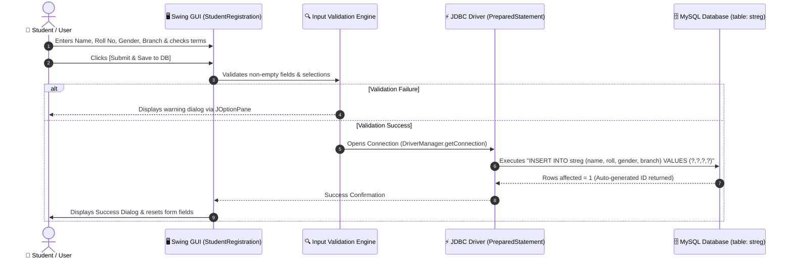

# Experiment 05: Database-Driven GUI Application (Swing + JDBC Integration)

## 🎯 Aim & Objective
To architect, develop, and test a full desktop database application by integrating a graphical **Java Swing user interface** with a backend **MySQL relational database** using JDBC `PreparedStatement` transactions, demonstrating end-to-end form validation, exception management, and data persistence.

---

## 🛠️ Technology Stack
- **Language:** Java (JDK 17 or higher)
- **GUI Framework:** Java Swing (`javax.swing.*`, `java.awt.*`)
- **Database Engine:** MySQL Server 8.0+
- **JDBC Driver:** MySQL Connector/J (`mysql-connector-j-26.7.0.jar`)
- **Threading Model:** Swing Event Dispatch Thread (`SwingUtilities.invokeLater`)

---

## 📂 Directory Structure
```
05-Swing-JDBC-Registration/
├── lib/
│   └── mysql-connector-j-26.7.0.jar  # MySQL JDBC Driver JAR
├── src/
│   └── StudentRegistration.java      # Combined Swing GUI form & JDBC persistence layer
├── schema.sql                        # MySQL DDL table script for 'streg'
└── README.md                         # Detailed documentation and execution guide
```

---

## 💡 Architecture & Application Flow



---

## 🗄️ Database Setup

Run the schema script to prepare MySQL:

```bash
mysql -u root -p < schema.sql
```

Or execute via MySQL client:
```sql
CREATE DATABASE IF NOT EXISTS college_db;
USE college_db;

CREATE TABLE IF NOT EXISTS streg (
    id INT AUTO_INCREMENT PRIMARY KEY,
    name VARCHAR(100) NOT NULL,
    roll VARCHAR(50) NOT NULL,
    gender VARCHAR(10) NOT NULL,
    branch VARCHAR(50) NOT NULL,
    created_at TIMESTAMP DEFAULT CURRENT_TIMESTAMP
);
```

---

## 🚀 How to Compile & Run

### Windows (PowerShell / Command Prompt)
```powershell
cd 05-Swing-JDBC-Registration

# Compile the source code into the bin directory
javac -cp "lib/*" -d bin src/StudentRegistration.java

# Launch the database-connected Swing GUI application
java -cp "bin;lib/*" StudentRegistration
```

### Linux / macOS (Terminal)
```bash
cd 05-Swing-JDBC-Registration

# Compile
javac -cp "lib/*" -d bin src/StudentRegistration.java

# Run
java -cp "bin:lib/*" StudentRegistration
```

---

## 📋 Sample Run & Verification
1. **Launch:** Run the program. An interactive 700x560 desktop window opens with modern font hierarchy.
2. **Submit Validation:** Click Submit without filling fields. The app notifies which field is missing.
3. **Save Record:**
   - Enter `Name: Pankaj Sharma`
   - Enter `Roll Number: 21UCS101`
   - Select `Gender: Male`
   - Enter `Branch: Computer Science & Engineering`
   - Check `[x] I accept Terms & Conditions`
   - Click `Submit & Save to DB`
4. **Database Verification:**
   Query MySQL to verify the inserted record:
   ```sql
   SELECT * FROM streg;
   ```
   *Expected DB Output:*
   ```
   +----+---------------+----------+--------+--------------------------------+---------------------+
   | id | name          | roll     | gender | branch                         | created_at          |
   +----+---------------+----------+--------+--------------------------------+---------------------+
   |  1 | Pankaj Sharma | 21UCS101 | Male   | Computer Science & Engineering | 2026-10-20 10:05:00 |
   +----+---------------+----------+--------+--------------------------------+---------------------+
   ```

---

## 📚 Viva Questions & Conceptual Insights
1. **Why is combining GUI with JDBC often structured in layers (DAO pattern)?**  
   In enterprise systems, UI and database persistence are separated into Data Access Objects (DAOs) and Services to adhere to the Single Responsibility Principle and decouple UI from database schemas.
2. **How does `PreparedStatement` protect against SQL injection in user-entered form data?**  
   PreparedStatement compiles the SQL template once. User inputs are injected into placeholders (`?`) as strictly literal values, meaning characters like `'` or `;` or `--` cannot alter the SQL command syntax.
3. **What is the significance of `AUTO_INCREMENT` on primary keys?**  
   It delegates unique ID generation to the database engine, avoiding race conditions and key collisions when multiple clients submit records concurrently.

---

## 👤 Author
- **Developer:** Pankaj Sharma
- **Repository:** [Java-programs](https://github.com/Pankaj7437/Java-programs)
