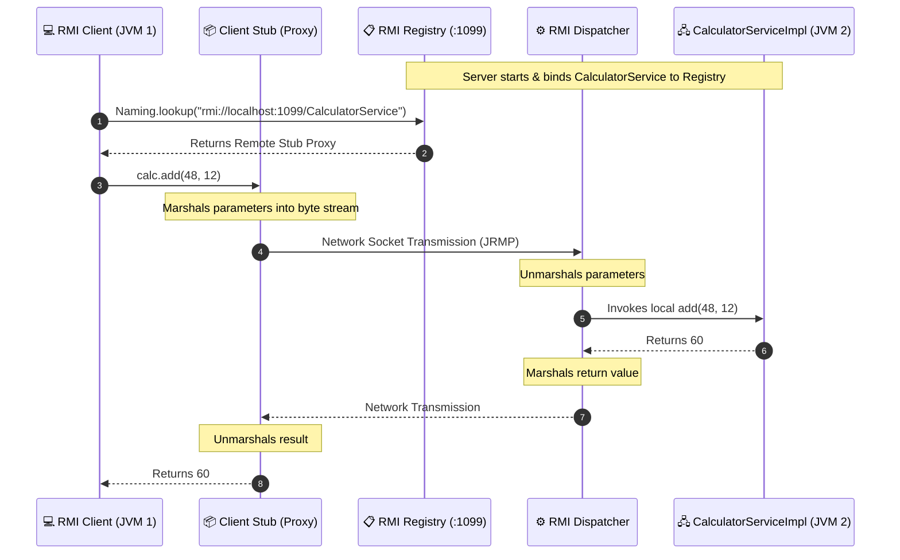

# Experiment 06: Distributed Computing via Java Remote Method Invocation (RMI)

## 🎯 Aim & Objective
To design, implement, and analyze a distributed client-server application using **Java Remote Method Invocation (RMI)**, enabling a client program executing in one Java Virtual Machine (JVM) to invoke methods on a remote object executing in a separate JVM across network boundaries.

---

## 🛠️ Technology Stack
- **Language:** Java (JDK 17 or higher)
- **Distributed Computing API:** Java RMI (`java.rmi.*`, `java.rmi.server.*`, `java.rmi.registry.*`)
- **Default Registry Port:** TCP `1099`

---

## 📂 Directory Structure
```
06-Java-RMI/
├── CalculatorService.java       # Remote Interface (extends java.rmi.Remote)
├── CalculatorServiceImpl.java   # Remote Implementation (extends UnicastRemoteObject)
├── RmiServer.java               # Server Host (initializes registry & binds servant stub)
├── RmiClient.java               # Client Consumer (performs lookup & invokes remote methods)
└── README.md                    # Detailed documentation and execution guide
```

---

## 💡 Architecture & Stub-Skeleton Mechanism



### Key Components
1. **`CalculatorService`**: The remote interface defining mathematical operations (`add`, `subtract`, `multiply`, `divide`). Extends `java.rmi.Remote`; all methods declare `throws RemoteException`.
2. **`CalculatorServiceImpl`**: Extends `UnicastRemoteObject`. Automatically exports the remote servant object for incoming point-to-point network requests.
3. **`RmiServer`**: Programmatically starts an in-process RMI registry on port `1099` using `LocateRegistry.createRegistry(1099)` and binds the remote object via `Naming.rebind()`.
4. **`RmiClient`**: Resolves the remote object reference through `Naming.lookup()` and transparently invokes arithmetic operations as if calling a local Java object.

---

## 🚀 How to Compile & Run

Execution requires **two terminal windows**.

### Step 1: Open Terminal 1 (Start Server)
```powershell
cd 06-Java-RMI

# Compile all RMI source files
javac *.java

# Start the RMI Server Host
java RmiServer
```
*Expected Server Output:*
```
==================================================
            JAVA RMI SERVER INITIALIZING          
==================================================
[INFO] Embedded RMI Registry started on port 1099
[SUCCESS] Service bound successfully: rmi://localhost:1099/CalculatorService
[INFO] RMI Server is ready and listening for remote method calls.
[INFO] Press Ctrl+C in this terminal to stop the server.
```

### Step 2: Open Terminal 2 (Run Client)
```powershell
cd 06-Java-RMI

# Launch the RMI Client
java RmiClient
```
*Expected Client Output:*
```
==================================================
            JAVA RMI CLIENT CONNECTING            
==================================================
[INFO] Looking up remote service at: rmi://localhost:1099/CalculatorService
[SUCCESS] Remote Stub obtained successfully!

Invoking Remote Methods with inputs (a = 48, b = 12):
--------------------------------------------------
[REMOTE CALL] add(48, 12)      = 60
[REMOTE CALL] subtract(48, 12) = 36
[REMOTE CALL] multiply(48, 12) = 576
[REMOTE CALL] divide(48, 12)   = 4.0
--------------------------------------------------
[SUCCESS] All remote procedure invocations completed successfully.
```

---

## 📚 Viva Questions & Conceptual Insights
1. **What is Marshalling and Unmarshalling in Java RMI?**  
   - **Marshalling:** Packaging method call arguments or return objects into a serialized byte stream suitable for network transmission across JVM boundaries.
   - **Unmarshalling:** Reconstructing serialized byte streams back into live Java objects inside the target JVM.
2. **Why must remote methods throw `RemoteException`?**  
   Because distributed calls are subject to network failures, latency timeouts, connection drops, or remote JVM crashes. `RemoteException` forces the calling client to handle communication failures gracefully.
3. **What is the role of `UnicastRemoteObject`?**  
   It provides basic support for point-to-point remote references, exporting the object so it listens on an anonymous TCP port for incoming client invocation requests.

---

## 👤 Author
- **Developer:** Pankaj Sharma
- **Repository:** [Java-programs](https://github.com/Pankaj7437/Java-programs)
