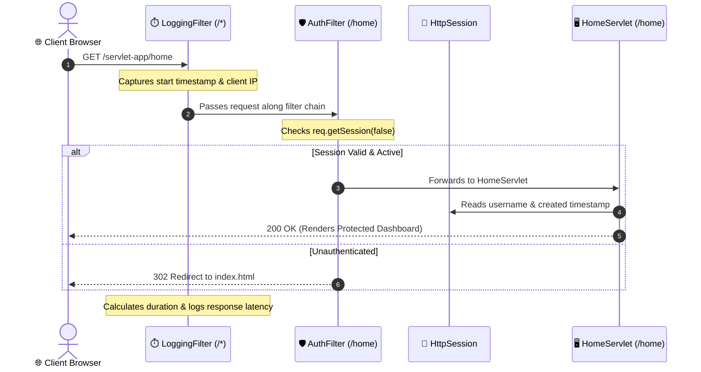

# Experiment 07: Java Servlets, Sessions, Filters, and Listeners

## 🎯 Aim & Objective
To develop, package, and deploy a dynamic Java Web Application utilizing the **Jakarta Servlet 6.0 API** (compatible with Apache Tomcat 10.1+), demonstrating HTTP request/response handling, form processing, session tracking (`HttpSession`), request interception (`@WebFilter`), and application lifecycle events (`@WebListener`).

---

## 🛠️ Technology Stack
- **Language:** Java (JDK 17 or higher)
- **Servlet Specification:** Jakarta Servlet API 6.0.0 (`jakarta.servlet.*`)
- **Build & Packaging:** Apache Maven 3.8+ (WAR Packaging)
- **Deployment Target:** Apache Tomcat 10.1+ (or 11.0+)

---

## 📂 Directory Structure
```
07-Servlet-Web-App/
├── pom.xml                                   # Maven configuration file (WAR packaging)
├── src/main/
│   ├── java/com/advancedjava/servlet/
│   │   ├── HelloServlet.java                 # Form processing & parameter extraction
│   │   ├── LoginServlet.java                 # Authentication & session creation
│   │   ├── HomeServlet.java                  # Protected user dashboard (session consumer)
│   │   ├── LogoutServlet.java                # Session invalidation & teardown
│   │   ├── AuthFilter.java                   # Security filter guarding /home
│   │   ├── LoggingFilter.java                # Global request logger & latency counter
│   │   ├── AppListener.java                  # ServletContextListener (app lifecycle)
│   │   └── SessionListener.java              # HttpSessionListener (active session tracker)
│   └── webapp/
│       ├── index.html                        # Interactive styled HTML portal
│       └── WEB-INF/
│           └── web.xml                       # Deployment descriptor
└── README.md                                 # Comprehensive documentation and run guide
```

---

## 💡 Architecture & Filter Chain Flow



### Module Highlights
1. **`HelloServlet` (`/hello`):** Demonstrates reading query and form body parameters (`request.getParameter()`), input sanitization, and outputting dynamic HTML responses.
2. **`LoginServlet` (`/login`):** Validates user credentials. Upon success, calls `request.getSession(true)`, stores user identification attributes, sets maximum idle timeout (30 minutes), and redirects to `/home`.
3. **`HomeServlet` (`/home`):** Renders personalized content using attributes retrieved from the current `HttpSession`.
4. **`LogoutServlet` (`/logout`):** Destroys user credentials via `session.invalidate()` and redirects to home.
5. **`AuthFilter` (`/home`):** Enforces access control by verifying that `request.getSession(false)` contains an authenticated user attribute before granting access to protected servlets.
6. **`LoggingFilter` (`/*`):** Intercepts every request and response, logging the HTTP verb, target URI, client IP, and millisecond processing latency.
7. **`AppListener` & `SessionListener`:** Event-driven components reacting to container startup, application context termination, and active user session counts.

---

## 🚀 How to Build & Deploy

### Prerequisites
- **JDK 17+** and **Apache Maven 3.8+** installed:
  ```bash
  mvn -version
  ```
- **Apache Tomcat 10.1+** installed and extracted.

### Step 1: Build the WAR Package with Maven
```powershell
cd 07-Servlet-Web-App

# Clean and package WAR archive
mvn clean package
```
*Maven creates the deployable archive at: `target/servlet-app.war`*

### Step 2: Deploy onto Apache Tomcat 10.1+
```powershell
# Copy generated WAR to Tomcat webapps directory
# (Replace with your Tomcat path)
Copy-Item target/servlet-app.war "C:\apache-tomcat-10.1.x\webapps\"

# Start Apache Tomcat
& "C:\apache-tomcat-10.1.x\bin\startup.bat"
```
*(On Linux/macOS, use `cp target/servlet-app.war $CATALINA_HOME/webapps/` and `./startup.sh`)*

### Step 3: Access via Web Browser
- **Portal Landing Page:** [http://localhost:8080/servlet-app/](http://localhost:8080/servlet-app/)
- **Hello Servlet:** Test form on the homepage or visit [http://localhost:8080/servlet-app/hello](http://localhost:8080/servlet-app/hello)
- **Login:** Enter `username: pankaj@example.com` and `password: secret123`.

---

## 📚 Viva Questions & Conceptual Insights
1. **What is the difference between `javax.servlet` and `jakarta.servlet`?**  
   Oracle transitioned Java EE to the Eclipse Foundation under the Jakarta EE brand. Starting from Tomcat 10 and Jakarta EE 9+, the namespace was migrated from `javax.servlet` to `jakarta.servlet`.
2. **How does `HttpSession` track clients across stateless HTTP requests?**  
   The server generates a unique session token (`JSESSIONID`) and delivers it to the browser as an HTTP cookie or through URL rewriting. The browser automatically includes this cookie in subsequent requests.
3. **What is the difference between `Filter` and `Servlet`?**  
   A `Servlet` generates the final HTTP response for a specific resource, whereas a `Filter` intercepts requests and responses before and after they reach servlets, ideal for cross-cutting concerns like authentication, encoding, compression, and logging.

---

## 👤 Author
- **Developer:** Pankaj Sharma
- **Repository:** [Java-programs](https://github.com/Pankaj7437/Java-programs)
