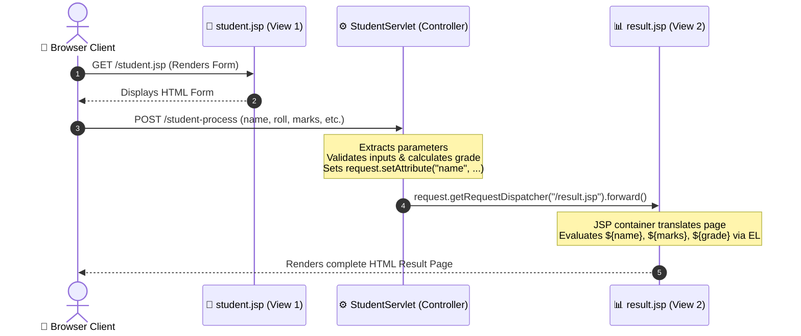

# Experiment 08: Dynamic Web Programming with Servlets & JavaServer Pages (JSP)

## 🎯 Aim & Objective
To architect and implement an interactive web application employing the **Model-View-Controller (MVC Model-2) web architecture**, combining **Jakarta Servlets** as the centralized request controller with **JavaServer Pages (JSP)** and **Expression Language (EL)** as dynamic presentation views.

---

## 🛠️ Technology Stack
- **Language:** Java (JDK 17 or higher)
- **Web APIs:** Jakarta Servlet API 6.0+, Jakarta Server Pages (JSP) API 3.1+
- **Presentation Technology:** JSP Directives, Standard Actions, Expression Language (`${...}`)
- **Build & Packaging:** Apache Maven (WAR format)
- **Servlet Container:** Apache Tomcat 10.1+ (or 11.0+)

---

## 📂 Directory Structure
```
08-Servlet-JSP-Practical/
├── pom.xml                                   # Maven POM for Jakarta EE 10 WAR
├── src/main/
│   ├── java/com/advancedjava/jsp/
│   │   └── StudentServlet.java               # Controller Servlet (processes input & forwards)
│   └── webapp/
│       ├── index.html                        # Portal entry page
│       ├── student.jsp                       # Input View: Form for collecting student data
│       ├── result.jsp                        # Output View: Renders evaluation report via EL
│       └── WEB-INF/
│           └── web.xml                       # Deployment descriptor
└── README.md                                 # Comprehensive documentation and run guide
```

---

## 💡 Architecture & MVC Web Flow (Model-2)



### Key Highlights
1. **Separation of Concerns (MVC Model-2):**
   - **Controller (`StudentServlet.java`):** Contains all request handling, validation, score evaluation, and page navigation routing.
   - **Input View (`student.jsp`):** Dedicated page focused strictly on collecting user parameters through semantic HTML5 inputs.
   - **Output View (`result.jsp`):** Renders the processed result using Expression Language (`${name}`, `${grade}`) without embedding messy scriptlet Java code (`<% ... %>`).
2. **Request Dispatcher Forwarding:** Uses `RequestDispatcher.forward(request, response)` to internally hand off request-scoped attributes to `result.jsp` on the server side without triggering an extra round-trip HTTP redirect.

---

## 🚀 How to Build & Deploy

### Prerequisites
- **JDK 17+** and **Apache Maven 3.8+**
- **Apache Tomcat 10.1+**

### Step 1: Build WAR Package with Maven
```powershell
cd 08-Servlet-JSP-Practical

# Package the Web Application Archive
mvn clean package
```
*Creates deployable archive at: `target/jsp-practical.war`*

### Step 2: Deploy to Apache Tomcat
```powershell
# Copy the war archive to Tomcat webapps directory
Copy-Item target/jsp-practical.war "C:\apache-tomcat-10.1.x\webapps\"

# Start Tomcat Server
& "C:\apache-tomcat-10.1.x\bin\startup.bat"
```
*(On Linux/macOS: `cp target/jsp-practical.war $CATALINA_HOME/webapps/` and `./startup.sh`)*

### Step 3: Access via Browser
- **Portal Landing:** [http://localhost:8080/jsp-practical/](http://localhost:8080/jsp-practical/)
- **Registration Form:** [http://localhost:8080/jsp-practical/student.jsp](http://localhost:8080/jsp-practical/student.jsp)

---

## 📋 Sample Run & Verification
1. **Navigate to:** `http://localhost:8080/jsp-practical/student.jsp`
2. **Submit Student Record:**
   - Name: `Pankaj Sharma`
   - Roll Number: `21UCS101`
   - Age: `21`
   - Email: `pkscreations7437@gmail.com`
   - Course: `B.Tech Computer Science`
   - Score (%): `92.5`
   - Click `Submit to Controller Servlet`
3. **Verify Output:**
   `StudentServlet` calculates grade `A+ (Outstanding)` and forwards to `result.jsp`, which outputs the formatted tabular card.

---

## 📚 Viva Questions & Conceptual Insights
1. **What is the difference between `RequestDispatcher.forward()` and `HttpServletResponse.sendRedirect()`?**  
   - `forward()` happens entirely on the server within the same HTTP request/response cycle, preserving request-scope attributes. The URL in the client's browser does not change.
   - `sendRedirect()` returns a 302 HTTP status code to the client browser, forcing it to initiate a brand-new GET request. Request-scope attributes are lost.
2. **What is JSP Expression Language (EL)?**  
   EL (`${expr}`) provides a clean, concise syntax for accessing JavaBeans components, request/session/application attributes, and parameters without having to write scriptlet tags (`<%= request.getAttribute(...) %>`).
3. **What is the lifecycle of a JSP page?**  
   1. Translation (JSP translated into a Java Servlet `.java` source file)
   2. Compilation (compiled into `.class` bytecode)
   3. Loading & Instantiation (`jspInit()`)
   4. Request Servicing (`_jspService()`)
   5. Destruction (`jspDestroy()`)

---

## 👤 Author
- **Developer:** Pankaj Sharma
- **Repository:** [Java-programs](https://github.com/Pankaj7437/Java-programs)
