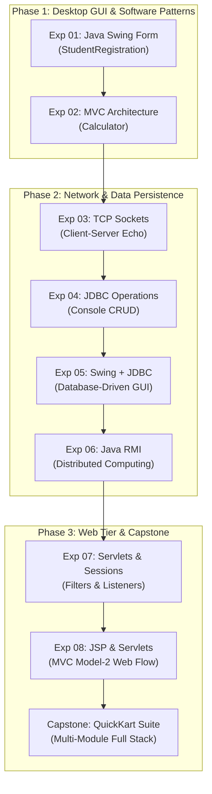

# ☕ Advanced Java Programming Laboratory & Enterprise Capstone

> **A Comprehensive Academic & Enterprise Java Repository:** 8 Rigorous Laboratory Experiments + Production-Grade E-Commerce Capstone (**QuickKart**) deployed live on Cloud Infrastructure.

[](https://adoptium.net)
[](https://jakarta.ee)
[](https://tomcat.apache.org)
[](https://www.mysql.com)
[](http://20.2.193.248:8080/)
[](http://20.2.193.248:8080/)

---

## 🌐 Live Azure VM Cloud Deployment
The capstone e-commerce enterprise suite (**QuickKart**) is built, containerized, and deployed live in production:

🔗 **Production Storefront URL:** [**http://20.2.193.248:8080/**](http://20.2.193.248:8080/)  
- **Admin Portal:** [http://20.2.193.248:8080/admin/](http://20.2.193.248:8080/admin/)  
- **Health Check Endpoint:** [http://20.2.193.248:8080/health](http://20.2.193.248:8080/health)

---

## 📖 Curriculum Overview & Structure

This repository provides an end-to-end, structured progression through the **Advanced Java Programming Laboratory (ADJ Lab)** curriculum. 

While conventional academic collections frequently combine or omit practicals (such as presenting only 7 experiments by missing standalone GUI-to-database persistence), this repository provides the complete, authoritative **8 core experiments** followed by a full-scale **enterprise capstone project**.



---

## 📑 Index of Experiments

| Exp No. | Experiment Title | Core Technologies | Directory Link |
| :---: | :--- | :--- | :---: |
| **01** | **Interactive Student Registration GUI Form** | Java Swing, AWT, Event Handling (`ActionListener`) | [📁 `01-StudentRegistration/`](01-StudentRegistration/) |
| **02** | **Model-View-Controller (MVC) Pattern Calculator** | Separation of Concerns, Swing UI, Event Dispatching | [📁 `02-MVC-Calculator/`](02-MVC-Calculator/) |
| **03** | **TCP Socket Client-Server Network Communication** | Java Networking (`java.net`), Sockets, I/O Streams | [📁 `03-ClientServer-Sockets/`](03-ClientServer-Sockets/) |
| **04** | **Java Database Connectivity (JDBC) CRUD Operations** | JDBC Type-4 Driver, MySQL, `PreparedStatement`, `ResultSet` | [📁 `04-JDBC-Database-Operations/`](04-JDBC-Database-Operations/) |
| **05** | **Database-Driven GUI Application (Swing + JDBC)** | Swing GUI + MySQL Persistence Layer, Input Validation | [📁 `05-Swing-JDBC-Registration/`](05-Swing-JDBC-Registration/) |
| **06** | **Distributed Computing via Java RMI** | Remote Method Invocation, RMI Registry, Stub Proxies | [📁 `06-Java-RMI/`](06-Java-RMI/) |
| **07** | **Java Servlets, Sessions, Filters & Listeners** | Jakarta Servlet 6.0, `HttpSession`, `@WebFilter`, `@WebListener` | [📁 `07-Servlet-Web-App/`](07-Servlet-Web-App/) |
| **08** | **Dynamic Web Programming with Servlets & JSP** | MVC Model-2 Web Flow, JSP Expression Language (EL), Views | [📁 `08-Servlet-JSP-Practical/`](08-Servlet-JSP-Practical/) |
| **⭐** | **Capstone: QuickKart Enterprise E-Commerce Platform** | Jakarta EE 10, JSP 3.1, FlatLaf Swing Admin, Sockets, RMI, Azure VM | [🚀 `quickkart/`](quickkart/) |

---

## 🧪 Detailed Laboratory Experiments

### 1. [Experiment 01: Student Registration GUI Form](01-StudentRegistration/)
- **Focus:** Constructing cross-platform desktop user interfaces using Java Swing (`JFrame`, `JLabel`, `JTextField`, `JRadioButton`, `ButtonGroup`, `JCheckBox`, `JButton`, `JOptionPane`).
- **Core Concept:** Layout management with absolute bounds and event handling using `ActionListener`.
- **Run Command:**
  ```bash
  cd 01-StudentRegistration && javac StudentRegistration.java && java StudentRegistration
  ```
- **Documentation:** See [01-StudentRegistration/README.md](01-StudentRegistration/README.md).

---

### 2. [Experiment 02: MVC Pattern Calculator](02-MVC-Calculator/)
- **Focus:** Practical software architecture adhering strictly to the **Model-View-Controller** design pattern.
- **Components:**
  - `CalculatorModel.java`: Encapsulates arithmetic logic, zero-division exceptions.
  - `CalculatorView.java`: Clean Swing display and button layout.
  - `CalculatorController.java`: Bridges View events to Model execution.
- **Run Command:**
  ```bash
  cd 02-MVC-Calculator && javac *.java && java Main
  ```
- **Documentation:** See [02-MVC-Calculator/README.md](02-MVC-Calculator/README.md).

---

### 3. [Experiment 03: TCP Socket Client-Server Communication](03-ClientServer-Sockets/)
- **Focus:** Point-to-point network communication using reliable TCP/IP protocols over Java stream sockets.
- **Components:**
  - `Server.java`: Binds on port `5000`, receives client text streams, and returns formatted uppercase echoes.
  - `Client.java`: Interactive command-line client reading user keyboard input and communicating with the server.
- **Run Command (Two Terminals):**
  ```bash
  # Terminal 1:
  cd 03-ClientServer-Sockets && javac *.java && java Server
  # Terminal 2:
  cd 03-ClientServer-Sockets && java Client
  ```
- **Documentation:** See [03-ClientServer-Sockets/README.md](03-ClientServer-Sockets/README.md).

---

### 4. [Experiment 04: JDBC Database Operations (Console CRUD)](04-JDBC-Database-Operations/)
- **Focus:** Relational database integration using the MySQL Connector/J Type-4 JDBC driver.
- **Features:** Parameterized queries with `PreparedStatement` preventing SQL injection, cursor processing with `ResultSet`, and resource teardown with try-with-resources.
- **Run Command:**
  ```bash
  cd 04-JDBC-Database-Operations
  javac -cp "lib/*" -d bin src/Main.java
  java -cp "bin;lib/*" Main   # (Use ':' instead of ';' on Linux/macOS)
  ```
- **Documentation:** See [04-JDBC-Database-Operations/README.md](04-JDBC-Database-Operations/README.md).

---

### 5. [Experiment 05: Database-Driven GUI Application (Swing + JDBC)](05-Swing-JDBC-Registration/)
- **Focus:** Full integration of a desktop Swing registration form with automated MySQL database persistence.
- **Features:** Comprehensive front-end validation, transactional `INSERT` via `PreparedStatement`, auto-incremented primary keys, and real-time database confirmation modals.
- **Run Command:**
  ```bash
  cd 05-Swing-JDBC-Registration
  javac -cp "lib/*" -d bin src/StudentRegistration.java
  java -cp "bin;lib/*" StudentRegistration
  ```
- **Documentation:** See [05-Swing-JDBC-Registration/README.md](05-Swing-JDBC-Registration/README.md).

---

### 6. [Experiment 06: Distributed Computing via Java RMI](06-Java-RMI/)
- **Focus:** Object-oriented distributed client-server systems via Java Remote Method Invocation.
- **Components:**
  - `CalculatorService.java`: Remote interface declaring operations.
  - `CalculatorServiceImpl.java`: Servant implementation extending `UnicastRemoteObject`.
  - `RmiServer.java`: Automatic registry initialization on port `1099` and servant binding.
  - `RmiClient.java`: Transparent remote object lookup and invocation.
- **Run Command (Two Terminals):**
  ```bash
  # Terminal 1:
  cd 06-Java-RMI && javac *.java && java RmiServer
  # Terminal 2:
  cd 06-Java-RMI && java RmiClient
  ```
- **Documentation:** See [06-Java-RMI/README.md](06-Java-RMI/README.md).

---

### 7. [Experiment 07: Java Servlets, Sessions, Filters & Listeners](07-Servlet-Web-App/)
- **Focus:** Enterprise Java web programming using the Jakarta Servlet 6.0 API.
- **Features:**
  - `HelloServlet`: POST parameter extraction and dynamic HTML rendering.
  - `LoginServlet` & `HomeServlet`: State management with `HttpSession`.
  - `AuthFilter`: Path security interceptor protecting `/home`.
  - `LoggingFilter`: Global latency and request audit logger.
  - `AppListener` & `SessionListener`: Application and session lifecycle trackers.
- **Packaging:** Maven WAR packaging deployable on Apache Tomcat 10.1+.
- **Documentation:** See [07-Servlet-Web-App/README.md](07-Servlet-Web-App/README.md).

---

### 8. [Experiment 08: Dynamic Web Programming with Servlets & JSP](08-Servlet-JSP-Practical/)
- **Focus:** Model-View-Controller (Model-2) web architecture combining Servlets as Controllers and JSP as presentation Views.
- **Features:** Form handling via `student.jsp`, parameter calculation in `StudentServlet`, and clean scriptlet-free rendering via Expression Language (`${...}`) in `result.jsp`.
- **Packaging:** Maven WAR project ready for Tomcat deployment.
- **Documentation:** See [08-Servlet-JSP-Practical/README.md](08-Servlet-JSP-Practical/README.md).

---

## ⭐ Final Capstone: QuickKart Enterprise E-Commerce Platform

[**QuickKart**](quickkart/) is a production-grade, multi-module distributed e-commerce system built to represent the pinnacle of enterprise Java engineering.

### Architectural Highlights
- **Full-Stack Web Storefront:** Jakarta EE 10, JSP 3.1, JSTL 3.0, and modern responsive UI.
- **Desktop Administration Panel:** High-performance native Java Swing desktop app styled with **FlatLaf** modern themes.
- **Distributed Microservices:**
  - **RMI Inventory Service (`quickkart-rmi`):** Live remote method calls for product stock verification.
  - **TCP Socket Stream Service (`quickkart-network`):** Low-level socket server streaming serialized catalog updates on port `9090`.
- **Database & Pooling:** MySQL 8.0 integrated with **HikariCP** high-speed connection pooling.
- **Cloud Infrastructure:** Multi-stage Docker container deployed live on an **Azure Virtual Machine**:
  👉 **Live URL:** [**http://20.2.193.248:8080/**](http://20.2.193.248:8080/)

For full details, installation instructions, and launch scripts, visit the [**QuickKart Module Documentation**](quickkart/README.md) and [**QuickKart Run Guide**](quickkart/HOW_TO_RUN.md).

---

## 🛠️ System Prerequisites

To compile and execute all modules across this repository, ensure your workstation is equipped with:
1. **Java Development Kit (JDK 17 LTS or JDK 21 LTS)**
   ```bash
   java -version
   javac -version
   ```
2. **MySQL Database Server 8.0+**
   ```bash
   mysql --version
   ```
3. **Apache Maven 3.8+** (for packaging Servlet WAR modules)
   ```bash
   mvn -version
   ```
4. **Apache Tomcat 10.1+** (for hosting Experiments 07 & 08 locally)
5. **Docker & Docker Compose** (optional, for deploying QuickKart container images)

---

## 👤 Author & Contributor

- **Author & Maintainer:** **Pankaj Sharma**
- **GitHub Profile:** [@Pankaj7437](https://github.com/Pankaj7437)
- **Repository:** [Java-programs](https://github.com/Pankaj7437/Java-programs)
- **Email:** `pkscreations7437@gmail.com`

---

## 📜 Academic Integrity & License
This laboratory repository is developed for educational and academic excellence. All code and documentation are maintained by Pankaj Sharma. All rights reserved &copy; 2026.
