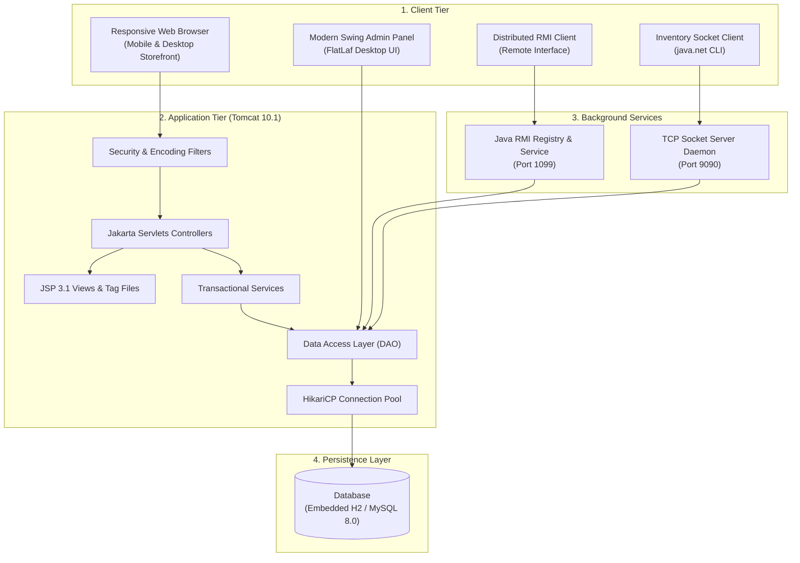

# QuickKart Enterprise E-Commerce Platform
> Production-Grade Jakarta EE 10 E-Commerce Suite, Modern FlatLaf Desktop Admin & Distributed Microservices

[](https://adoptium.net)
[](https://jakarta.ee)
[](https://tomcat.apache.org)
[](https://www.mysql.com)
[](https://www.docker.com)
[](https://www.formdev.com/flatlaf/)

---

## 1. Executive Summary & Capabilities

**QuickKart** is a full-featured, enterprise-grade Java E-Commerce platform built using modern engineering patterns and adhering strictly to the **RTU Advanced Java / Java Enterprise Application curriculum**.

### Key Highlights
- **Realistic Modern Storefront:**
  - High-converting modern UI with dark ambient lighting, subtle glassmorphism, micro-animations, and fluid typography.
  - **Flagship Studio Headphone Showcase:** Photorealistic studio headphone visual on the homepage hero with dynamic specs, rating, and promotional pricing (`₹12,749.15`).
  - **Full Multi-Device Responsiveness:** 2-column mobile layout (`col-6`), horizontal touch-scroll category chips (`scrollbar-none`), and slide-out **Offcanvas Filter Drawer** (`#offcanvasFilters`) on mobile and tablets.
- **Realistic Indian Rupee (₹) Pricing:**
  - 26 curated products across 12 departments (Laptops at ₹89,999, Flagship ANC Headphones at ₹14,999, Automatic Luxury Watches at ₹28,500, Footwear at ₹2,999 - ₹6,799, Casual Wear at ₹1,899 - ₹2,799).
  - Free express delivery threshold for orders above ₹499 (otherwise ₹49 fee).
- **Modern Desktop Administration (`quickkart-swing-admin`):**
  - Modern FlatLaf Look and Feel with font anti-aliasing and rounded inputs (`Button.arc=10`).
  - Real-time search filter (`TableRowSorter`), color-coded stock alerts, formatted currency (`₹%,.2f`), and product management dialogs.
  - Linux Desktop Launcher (`QuickKart-Admin.desktop`) and Windows 1-click launcher (`run-swing-admin.bat`).
- **Distributed Enterprise Services:**
  - **Java RMI (`quickkart-rmi`):** Remote Method Invocation inventory and pricing lookup service on port 1099.
  - **Java Sockets (`quickkart-network`):** Standalone `ServerSocket` daemon on port 9090 streaming serialized Java objects.
- **Zero-Friction Execution:**
  - Runs out-of-the-box on both **Windows** and **Linux** with either embedded zero-setup H2 database or external MySQL 8.0.

---

## 2. System Architecture



### Visual Architecture Flow
```
+-----------------------------------------------------------------------------------+
|                                  CLIENT TIER                                      |
|  +--------------------+  +--------------------+  +-------------+  +------------+  |
|  | Web Browser (Store)|  | Swing Admin (Admin)|  | Socket CLI  |  | RMI Client |  |
|  +---------+----------+  +---------+----------+  +------+------+  +-----+------+  |
+------------|-----------------------|--------------------|---------------|---------+
             | HTTP (8080)           | Direct DAO / JDBC  | TCP (9090)    | RMI (1099)
             v                       |                    v               v
+---------------------------------+  |             +--------------+ +---------------+
|       TOMCAT 10.1 WEB APP       |  |             | Socket Server| |  RMI Registry |
|  Filters -> Servlets -> Services|  |             +-------+------+ +-------+-------+
|  JSP Views & Tags       |       |  |                     |                |
|                         v       |  |                     |                |
|                    DAOs (Layer) <---+---------------------+----------------+
|                         |
|                         v
|               HikariCP Connection Pool
+-------------------------+---------------------------------------------------------+
                          |
                          v
         +----------------------------------+
         | PERSISTENCE: H2 / MySQL 8.0 DB   |
         +----------------------------------+
```

---

## 3. Academic Deliverables & Syllabus Mapping

| RTU Syllabus Unit | Concept Implemented | Implementation Location in QuickKart |
| :--- | :--- | :--- |
| **Unit 1: Core Servlets** | Servlet Lifecycle, `HttpServletRequest`, `HttpServletResponse`, Session Tracking | [`CartServlet.java`](quickkart-web/src/main/java/com/quickkart/web/controller/CartServlet.java), [`AuthServlet.java`](quickkart-web/src/main/java/com/quickkart/web/controller/AuthServlet.java) |
| **Unit 2: Servlet Filters & Listeners** | `Filter`, `FilterChain`, `HttpSessionListener`, `ServletContextListener` | [`AuthenticationFilter.java`](quickkart-web/src/main/java/com/quickkart/web/filter/AuthenticationFilter.java), [`AppContextListener.java`](quickkart-web/src/main/java/com/quickkart/web/listener/AppContextListener.java) |
| **Unit 3: JavaServer Pages (JSP)** | Scriptlets, Declarations, Directives, Expressions, Action Tags | [`traditional-jsp.jsp`](quickkart-web/src/main/webapp/syllabus/traditional-jsp.jsp), [`index.jsp`](quickkart-web/src/main/webapp/index.jsp) |
| **Unit 4: JSTL & Custom Tags** | JSTL Core, Formatting, XML Transformation, SQL Demo, Tag Files | [`productCard.tag`](quickkart-web/src/main/webapp/WEB-INF/tags/productCard.tag), [`jstl-xml.jsp`](quickkart-web/src/main/webapp/syllabus/jstl-xml.jsp) |
| **Unit 5: JDBC & Connection Pools** | PreparedStatements, HikariCP, Transactions, ACID rollbacks | [`DBConnectionPool.java`](quickkart-dao/src/main/java/com/quickkart/dao/db/DBConnectionPool.java), [`OrderDAOImpl.java`](quickkart-dao/src/main/java/com/quickkart/dao/impl/OrderDAOImpl.java) |
| **Unit 6: Java Swing GUI** | Swing MVC, Layouts, Pluggable Look and Feel (FlatLaf), `JTable` | [`MainSwingAdmin.java`](quickkart-swing-admin/src/main/java/com/quickkart/swing/MainSwingAdmin.java), [`AdminDashboardFrame.java`](quickkart-swing-admin/src/main/java/com/quickkart/swing/view/AdminDashboardFrame.java) |
| **Unit 7: Networking (`java.net`)** | `ServerSocket`, `Socket`, Object Serialization over TCP | [`InventoryServer.java`](quickkart-network/src/main/java/com/quickkart/network/server/InventoryServer.java), [`InventoryClient.java`](quickkart-network/src/main/java/com/quickkart/network/client/InventoryClient.java) |
| **Unit 8: Distributed Computing (RMI)** | `Remote` interface, `UnicastRemoteObject`, `LocateRegistry` | [`InventoryRemoteService.java`](quickkart-rmi/src/main/java/com/quickkart/rmi/service/InventoryRemoteService.java), [`RmiServerLauncher.java`](quickkart-rmi/src/main/java/com/quickkart/rmi/server/RmiServerLauncher.java) |
| **Unit 9: Internationalization (i18n)** | `ResourceBundle`, `Locale`, Multi-lingual (English & Hindi) | [`traditional-jsp.jsp`](quickkart-web/src/main/webapp/syllabus/traditional-jsp.jsp), `messages_hi.properties` |
| **Unit 10: JNDI & DataSource** | Context lookup, DataSource resolution in Tomcat | [`jndi-demo.jsp`](quickkart-web/src/main/webapp/syllabus/jndi-demo.jsp) |

---

## 4. Multi-Module Project Structure

```
quickkart/
├── pom.xml                          # Parent Reactor POM
├── HOW_TO_RUN.md                    # Detailed Windows & Linux Setup & Execution Guide
├── mvnw & mvnw.cmd                  # Linux & Windows Maven Wrappers
├── run-web.sh / .bat                # Storefront Launcher
├── stop-web.sh / .bat               # Storefront Stopper
├── run-swing-admin.sh / .bat        # Desktop Swing Admin Launcher
├── run-rmi-test.sh / .bat           # Java RMI Distributed Service Launcher
├── run-network-test.sh / .bat       # Java Socket Network Daemon Launcher
├── run-tests.sh / .bat              # Integration & Unit Test Runner
├── QuickKart-Admin.desktop          # Linux Desktop Application Launcher
├── database/
│   ├── quickkart.sql               # MySQL 8.0 DDL & Complete Catalog Seed Data
│   └── update_prices.sql           # Realistic INR Pricing Script
├── docker/
│   ├── Dockerfile.web              # Production Container Image Build
│   ├── docker-compose.yml          # App + MySQL 8.0 + Nginx Orchestration
│   └── nginx/default.conf          # Reverse Proxy Configuration
├── docs/
│   ├── azure_vm_deployment_guide.md# Azure VM Setup & GitHub Actions Guide
│   └── rtu_viva_preparation_guide.md# Oral Examination & Viva Q&A
├── quickkart-common/                # Domain Models, BCrypt Utility, AppConfig
├── quickkart-dao/                   # HikariCP Connection Pool, DAOs, CheckoutService
├── quickkart-web/                   # Jakarta EE 10 WAR Web Application
├── quickkart-swing-admin/           # FlatLaf Modern Desktop Admin Panel
├── quickkart-network/               # java.net Socket/ServerSocket Client-Server
└── quickkart-rmi/                   # Distributed Java RMI Inventory Service
```

---

## 5. Quick Start (Windows & Linux)

For detailed step-by-step installation instructions for Windows and Linux, see [**HOW_TO_RUN.md**](HOW_TO_RUN.md).

### Quick Build & Test:
```bash
# 1. Build all modules
mvn clean package -DskipTests

# 2. Run automated test suites
mvn test
```

### Quick Run:
| Component | Linux Launcher | Windows Launcher | URL / Port |
| :--- | :--- | :--- | :--- |
| **Web Storefront & Admin** | `./run-web.sh` | `run-web.bat` | `http://localhost:8080/` |
| **Swing Desktop Admin** | `./run-swing-admin.sh` | `run-swing-admin.bat` | Desktop Window |
| **Java RMI Service Test** | `./run-rmi-test.sh` | `run-rmi-test.bat` | Port 1099 |
| **Java Socket Test** | `./run-network-test.sh` | `run-network-test.bat` | Port 9090 |
| **Integration Test Runner** | `./run-tests.sh` | `run-tests.bat` | Automated Test Harness |

---

## 6. Default Credentials & Coupons

- **Administrator:** `admin@quickkart.com` / `Admin@123`
- **Customer:** `customer@quickkart.com` / `Customer@123`
- **Active Coupons:**
  - `WELCOME10`: 10% off (Min order ₹999)
  - `FLAT20`: Flat ₹250 off (Min order ₹1,999)
  - `FESTIVE50`: Flat ₹500 off (Min order ₹4,999)
- **Free Shipping:** Automatic on orders over ₹499.

---

## 7. License & Credits

Built as an enterprise-grade academic capstone project adhering to RTU Advanced Java standards. All rights reserved &copy; 2026 QuickKart Inc.
